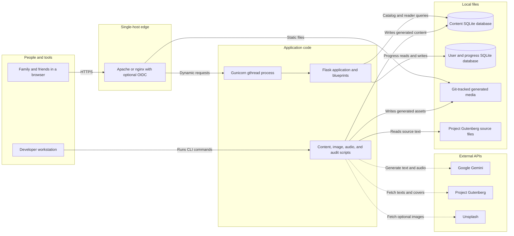
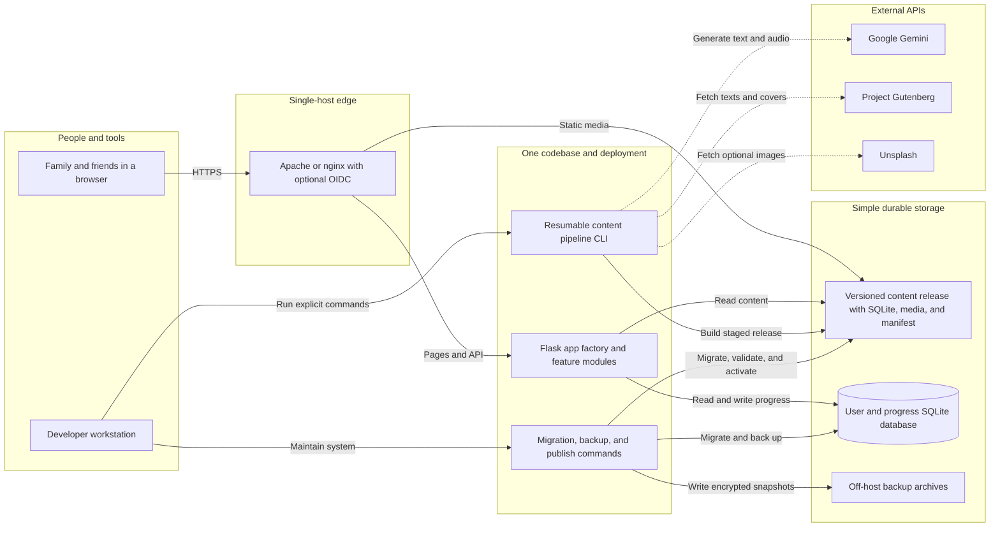
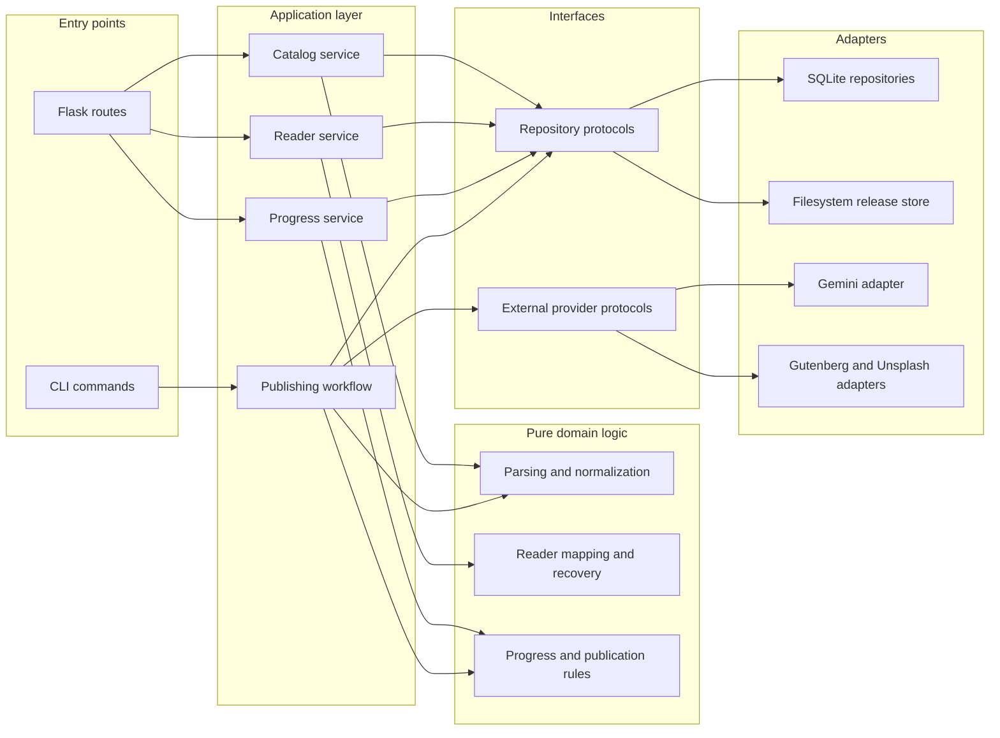

# Summra System Architecture

Status: proposed maintainability-focused target and current-state assessment  
Snapshot: `main` at `43f3798` on 2026-09-11  
Context: a personal application for family and friends, with low traffic and minimal operational or scaling requirements  
Scope: repository evidence plus the cohosted production topology documented in `deploy/`; live host configuration was not inspected

> **Updates since this snapshot (2026-10-12).** The assessment below is unchanged; these items have moved:
>
> - **Gap 6 — partly done.** `get_all_books()` now loads categories with one JOIN query instead of one query and connection per book. The other three examples (per-chapter audio probes, per-row side-by-side member queries, per-book manifest loads for library percentages) remain.
> - **Production topology confirmed.** The live VM was inspected: Apache (not nginx) terminates TLS, runs OIDC, serves `/summrabook/static/` directly, and proxies to Gunicorn on loopback. Gunicorn runs as a systemd *user* service of the service user. Apache does not compress proxied responses, so Flask now gzips HTML/JSON itself. The site is served over HTTP/1.1.
> - **Gap 7 — deploy docs.** The `CLAUDE.md` deploy runbook now matches the live host. `README.md` and `deploy/DEPLOY.md` drift is still open.
> - **Read path.** Pages no longer wait on the full `/api/books` catalog when they don't need it, and the reader manifest lists each segment's chapters. Details: `docs/ERD.md` → "First-Paint Server Rendering", "Catalog-Free Routing", "Server-Side Response Performance".
>
> Everything else here, including the P0 backup gap, is still current.

## Executive assessment

Summra should remain a **single-host modular monolith**.

The current coarse architecture is already appropriate: a reverse proxy, one Gunicorn/Flask process, two SQLite databases, local static files, and a separate operator-run content pipeline. Replacing those pieces with microservices, Kubernetes, managed PostgreSQL, a queue, Redis, or a multi-instance runtime would increase cost and maintenance without solving a real problem.

The ideal architecture is therefore an evolution of the current system:

- Keep one Flask application and one deployment unit.
- Keep SQLite, with separate content and user/progress databases.
- Keep media on the host and serve it directly through Apache/nginx.
- Keep AI/content generation outside the production request path.
- Introduce clean internal boundaries between routes, application services, repositories, and external providers.
- Turn the large content script into resumable, independently testable pipeline stages behind one CLI.
- Replace startup/read-path mutations with explicit migrations and publish commands.
- Package the database and generated media as a versioned content release that can be installed and rolled back together.
- Add simple, automatic off-host backups for the small amount of irreplaceable state.

The primary goal is to make future changes local, understandable, and reversible—not to make the system horizontally scalable.

## Architecture principles

1. **One deployable until there is a proven reason for another.** Internal modules are useful; network boundaries are not.
2. **Boring infrastructure is a feature.** A small VM, systemd, Gunicorn, SQLite, and filesystem assets fit the use case.
3. **Separate code by reason to change.** Reader behavior, progress, catalog, publishing, and external providers should not require edits to one shared god object.
4. **Keep pure logic pure.** Parsing, validation, alignment, and mapping logic should be callable without Flask, SQLite, files, or Gemini.
5. **Make side effects explicit.** Schema changes, content compilation, external API calls, and publication should occur through named commands—not constructors or GET requests.
6. **Publish content atomically.** A database and its media belong to one versioned release and should move together.
7. **Optimize for debugging by one person.** Prefer files, SQL, structured logs, and resumable state over extra services.
8. **Protect the data that cannot be regenerated.** User identity and reading progress require reliable backups even when traffic is tiny.

## Current system

### Current architecture diagram



### Runtime path

1. Apache or nginx terminates HTTPS, optionally performs OIDC, and serves `/static/` directly.
2. Dynamic requests are proxied over loopback to one Gunicorn process running `plainly.app_prod:app`.
3. Flask blueprints implement pages, catalog, reader, taxonomy, authors, progress, and system endpoints.
4. Public content is read from `data/database.db`.
5. Identity and reading progress are stored in `data/summra.db`.
6. Production does not call Gemini. It only returns pre-generated content and audio.

### Content path

1. An operator runs scripts from `scripts/` against Project Gutenberg source files.
2. The scripts parse book structure, call Gemini, generate text/audio/images, audit results, and write the content database and static directories.
3. Batch-state and raw-response files make some expensive work resumable.
4. Code is updated with Git and systemd; databases and generated media are moved through separate manual steps.

### What is already good

- Content generation is isolated from the request path, so external AI outages do not affect readers.
- Flask routes are split into blueprints without introducing distributed-system overhead.
- Content and user state are separated into two databases with different durability needs.
- Reader content has versions, immutable segments, ETags, paragraph mappings, and bounded payloads.
- Progress mutations have idempotency keys, device sequencing, and optimistic revisions.
- The proxy scrubs the trusted identity header and the application binds to loopback.
- The systemd unit has a narrow writable path and useful hardening.
- The project has substantial parser, model, route, and frontend test coverage.

## Repository analysis

Measurements from the snapshot above:

| Signal | Observed | Maintainability implication |
|---|---:|---|
| Flask route decorators | 45 | One application remains easy to operate; route dependencies should be explicit. |
| Content database | 684 MB | SQLite remains viable, but content publication should be deliberate and atomic. |
| Content rows | 90 books, 4,159 chapters, 11,911 segments, 417,804 reader paragraphs | Precompiled reader content is valuable; compilation does not belong on a GET path. |
| User database | 144 KB, 2 users, 4 reading states, 125 mutations | SQLite is more than sufficient; reliable backup matters more than scale. |
| Generated media | 402 MB across 474 tracked files | Generated binaries dominate Git and complicate code history and content rollback. |
| Git object pack | 566 MB | Clones and maintenance are paying for historical generated assets. |
| Largest files | `generate_summaries.py` 6,383 lines; `app.js` 2,795; `models.py` 2,514 | The main long-term risk is concentrated change surface, not traffic. |
| Python surface | 156 files, 87 classes, 1,118 functions | Shared conventions and dependency direction matter more than adding services. |
| Tests | 238 Python test functions and 31 JavaScript test calls | There is a strong base for incremental refactoring. |
| CI | pytest and bundle freshness; Ruff informational; browser smoke tests not run | Existing safety nets are not all enforced automatically. |

## Maintainability gaps

### 1. The persistence layer has too many responsibilities

`plainly/models.py` combines:

- schema definition and migration;
- catalog, summary, chapter, taxonomy, author, blog, and audio persistence;
- reader-content compilation and publication;
- reader queries, mapping, and recovery;
- filesystem checks for generated media.

Route modules access this through a mutable global (`common.db`). A change to a table, media layout, or reader algorithm can therefore affect many unrelated paths.

Desired change: capability-focused repositories behind explicit dependencies, while still using the same SQLite files.

### 2. Startup and read requests perform writes

- Constructing `Database` and `UserDatabase` immediately calls `init_db()`.
- `init_db()` performs table/index creation and caught `ALTER TABLE` statements.
- reader GET paths call `ensure_reader_content()`, which may compile and publish a new reader version.

This makes control flow surprising and refactoring risky. Application startup should validate its schema, and GET requests should only read. Migrations and reader compilation should be explicit CLI/publishing steps.

### 3. The content pipeline is one very large orchestration unit

The 6,383-line `generate_summaries.py` owns parsing, prompt construction, Gemini calls, retry/fallback behavior, batching, persistence, and CLI orchestration. Many tests exist, but changing one concern still requires navigating the entire file.

Desired change: preserve one command while extracting pure parsers, provider adapters, stage handlers, and a small workflow orchestrator.

### 4. Development and production behavior is assembled through import-time mutation

`app_base.py` creates a global Flask application. `app.py` and `app_prod.py` import and mutate that object, then add different TTS/admin/health routes.

Desired change: a real application factory that accepts environment-specific adapters. Production and development should share route definitions and differ through injected implementations, especially for TTS.

### 5. Code and generated content have no shared release unit

The content database and media files are updated separately. Audio existence is inferred from both database rows and filesystem naming conventions. Hundreds of megabytes of generated output are committed alongside source code.

Desired change: a small manifest that identifies one content release and every required database/media artifact. Stage it, validate it, then activate it with one symlink or configuration-pointer change.

This does not require a CDN or managed object storage. A directory on the VM plus an off-host archive is enough.

### 6. Some queries encode avoidable cross-layer work

Examples include:

- one category query/connection per book in `get_all_books()`;
- database and filesystem probes per chapter for audio availability;
- one member query per alignment row in side-by-side reader segments;
- one manifest load per library book to compute reading percentage.

At family-and-friends traffic these are not scaling problems. They are worth fixing only when touching the related code, because batched queries also produce simpler and more deterministic repository APIs.

### 7. Documentation describes multiple historical architectures

- `README.md` says auth defaults off, while current configuration enables it.
- `README.md` still describes removed offline/service-worker behavior.
- It places the user database at the repository root and references a removed auth blueprint.
- `docs/PROJECT_OVERVIEW.md` describes removed VITS-era components and an older pipeline.
- `deploy/DEPLOY.md` mixes current cohosting instructions with an older standalone deployment.

Desired change: make this document and `README.md` the current entry points; clearly mark historical documents as archived.

### 8. The irreplaceable database is missing from the backup example

`deploy/DEPLOY.md` backs up `data/database.db` but not `data/summra.db`. The user database uses WAL mode, so a plain copy of only the main file is also not a safe general backup method.

Desired change: one installed timer using SQLite's backup API to snapshot both databases to off-host storage, with a simple periodic restore check.

## Target architecture

### Target system diagram



### Target dependency direction



The dependency rule is the important part: entry points call application services; application services use pure domain logic and interfaces; SQLite, files, Flask, and Gemini remain replaceable adapters at the outside.

### Recommended module boundaries

The exact filenames can evolve incrementally. This is a destination, not a rewrite plan.

```text
plainly/
  app_factory.py
  config.py
  routes/
    pages.py
    catalog.py
    reader.py
    progress.py
    system.py
  services/
    catalog.py
    reader.py
    progress.py
  domain/
    reader.py
    progress.py
    errors.py
  repositories/
    protocols.py
    content_sqlite.py
    user_sqlite.py
  auth/
    ...

plainly/scripts/pipeline/
  cli.py
  workflow.py
  state.py
  stages/
    acquire.py
    parse.py
    summarize.py
    rewrite.py
    illustrate.py
    audio.py
    compile_reader.py
    validate.py
    publish.py
  providers/
    gemini.py
    gutenberg.py
    unsplash.py

plainly/frontend/static/js/
  api/
  router/
  features/
    catalog/
    reader/
    library/
    audio/
  shared/
```

Key rules:

- Route functions parse HTTP input and format HTTP output; they do not contain SQL or domain algorithms.
- Services coordinate use cases and transaction boundaries.
- Repositories own SQL and row-to-domain mapping.
- Domain functions have no Flask, SQLite, filesystem, or provider imports.
- Pipeline stages accept explicit input and produce explicit output/state.
- Provider adapters own SDK-specific retry, error translation, and model configuration.
- `app_factory.py` wires concrete adapters once for dev, tests, and production.

## Prioritized opportunities

### P0 — safe backups with almost no operational burden

Effort: small. Value: protects the only non-regeneratable data.

1. Add one Python backup command using `sqlite3.Connection.backup()` for both databases.
2. Run it daily with a systemd user timer.
3. Copy encrypted/compressed snapshots to an existing personal off-host location or a small bucket.
4. Keep simple daily/weekly retention.
5. Once a month, restore into `/tmp`, run `PRAGMA integrity_check`, and verify core row counts.

No PostgreSQL migration is warranted for current usage.

### P1 — introduce explicit application construction and dependencies

Effort: medium, incremental. Value: makes every later refactor safer.

1. Add `create_app(settings, dependencies)` while preserving existing routes.
2. Represent content repository, user repository, TTS lookup/generation, and identity resolution as small protocols.
3. Pass dependencies to blueprints/services rather than mutating module globals.
4. Register one TTS endpoint backed by either a development Gemini adapter or production file-only adapter.
5. Keep compatibility entry points in `app.py` and `app_prod.py` until deployment tests pass.

### P1 — split `Database` by capability without changing SQLite

Effort: medium. Value: reduces the 2,514-line change surface.

Extract in this order:

1. `UserProgressRepository` is already mostly separate; formalize its interface.
2. `ReaderQueryRepository` for manifests, segments, marker mapping, and recovery.
3. `ReaderPublisher` for compilation and content-version activation; CLI-only.
4. `CatalogRepository` for books, chapters, summaries, authors, and taxonomy.
5. `MediaRepository` for audio metadata and generated asset keys.

Use the current SQL directly. An ORM is optional and probably unnecessary; repository boundaries provide most of the maintainability benefit with less migration work.

### P1 — make migrations and publication explicit

Effort: medium. Value: removes hidden writes and makes rollback understandable.

1. Add numbered SQL/Python migrations plus a `schema_version` table for each database.
2. Make application startup fail with a clear error when a migration is required.
3. Move reader compilation out of `ensure_reader_content()` on GET paths and into `publish-content`.
4. Build content into a staging database/directory.
5. Validate it, then activate a versioned release with an atomic symlink swap.
6. Keep the previous release so rollback is one command.

### P1 — turn content generation into a staged workflow

Effort: medium to large, done gradually. Value: largest long-term code-maintenance payoff.

1. Characterize current behavior with tests before moving code.
2. Extract pure chapter parsing and normalization first; these have the richest tests and no provider dependency.
3. Move Gemini calls behind a provider adapter.
4. Give each stage an input checksum, output checksum, status, attempts, model/prompt version, and error.
5. Preserve one operator-facing command that runs stages in order and resumes incomplete work.
6. Make validation a required stage before publication.

A local JSON or SQLite job-state file is sufficient. A hosted queue is not needed.

### P1 — separate generated content from source history

Effort: medium. Value: smaller repository and clearer content rollback.

1. Define `content-release.json` with a release ID, schema version, database checksum, media checksums, and creation metadata.
2. Store releases outside the Git worktree on the VM and retain the active plus previous release.
3. Archive releases to the same off-host destination used for backups.
4. Stop committing new generated binaries after the release workflow is proven.
5. Plan any Git-history cleanup separately; do not rewrite history during the functional migration.

A CDN is unnecessary for expected traffic. Apache/nginx should continue serving local files directly.

### P2 — continue frontend decomposition by feature

Effort: incremental. Value: makes UI behavior easier to change without destabilizing the reader.

1. Keep extracting `app.js` behavior into ES modules grouped by feature.
2. Centralize fetch/response/error behavior in a small API client.
3. Keep reader state and progress synchronization independent of DOM rendering.
4. Prefer feature-level tests for routing, reader modes, progress, and audio.
5. Continue bundling to one production file with esbuild.

No frontend framework migration is required. Vanilla modules are adequate unless a future feature clearly benefits from a framework.

### P2 — tighten inexpensive quality gates

Effort: small to medium. Value: makes solo evolution safer.

1. Reduce Ruff's existing backlog, then make it blocking.
2. Run the existing JavaScript tests in CI.
3. Add one seeded Playwright smoke job for home, book, reader, and library paths.
4. Add a migration-from-previous-version test for each database.
5. Add content-release validation and rollback tests.
6. Keep `/health` simple, but verify the content DB, user DB, and active release are readable.

## Suggested implementation sequence

```mermaid
flowchart LR
    backups[Safe backups] --> appFactory[Application factory]
    appFactory --> repositorySeams[Repository interfaces]
    repositorySeams --> migrations[Explicit migrations]
    migrations --> pipelineStages[Extract pipeline stages]
    pipelineStages --> contentRelease[Atomic content release]
    contentRelease --> frontendModules[Frontend feature modules]
    frontendModules --> qualityGates[Complete quality gates]
```



### Phase 1: safety and seams

- Back up both SQLite databases safely.
- Add the app factory and explicit dependencies.
- Correct current README/deployment-document drift.
- Add characterization tests around route responses and repository behavior.

### Phase 2: persistence clarity

- Split query repositories by capability.
- Add versioned migrations.
- Move reader compilation to an explicit command.
- Batch obvious N+1 queries when moving the related repository methods.

### Phase 3: publishing clarity

- Extract pipeline stages behind the existing CLI.
- Add stage state, checksums, and resumability.
- Create and validate a versioned content-release manifest.
- Publish database/media together and support one-command rollback.

### Phase 4: ongoing evolution

- Continue frontend feature-module extraction.
- Make inexpensive CI gates blocking.
- Refactor only the areas needed by the next personal feature.

## Explicit non-goals

- No microservices.
- No Kubernetes.
- No managed PostgreSQL migration at current usage.
- No Redis or distributed cache.
- No job queue; local resumable workflow state is enough.
- No CDN requirement.
- No multi-instance deployment or autoscaling.
- No event bus or event-sourcing architecture.
- No ORM rewrite unless future query complexity makes it worthwhile.
- No frontend framework rewrite without a feature-driven reason.
- No real-time AI generation in the production request path.

## When to revisit these decisions

Reconsider infrastructure only if the personal-use assumptions change:

- SQLite write contention or corruption becomes an observed problem.
- The VM's recovery time becomes unacceptable despite tested backups.
- Multiple people need to run content jobs concurrently.
- Generated media no longer fits comfortably on the VM disk.
- Traffic or availability expectations grow beyond family-and-friends use.
- A separate maintainer needs independent ownership or deployment of one capability.

Until then, invest in module boundaries, explicit workflows, tests, and documentation rather than new services.

## Evidence map

- Application construction, dependency injection through globals, auth gating, and caching: `plainly/app_base.py`.
- Development/production route differences: `plainly/app.py`, `plainly/app_prod.py`.
- Content schema, startup migrations, repository breadth, reader compilation, and reader queries: `plainly/models.py`.
- User/progress schema, WAL mode, optimistic revisions, and mutation idempotency: `shared/auth/user_models.py`.
- Progress validation and library assembly: `shared/progress/routes.py`.
- Public book/reader APIs and per-item audio checks: `plainly/routes/books.py`.
- Trusted-header identity: `shared/auth/pchauth/`, `deploy/apache/summra.conf`.
- Runtime sizing and sandbox: `deploy/gunicorn_config.py`, `deploy/systemd/summra.service`.
- Update, media-copy, and backup procedures: `deploy/install.sh`, `deploy/README.md`, `deploy/DEPLOY.md`.
- CI: `.github/workflows/ci.yml`.
- Content generation and audits: `plainly/scripts/content/generate_summaries.py`, `plainly/scripts/content/generate_modern_english.py`, `plainly/scripts/images/`, `plainly/scripts/audio/`, `plainly/scripts/audits/`.
- Frontend structure: `plainly/frontend/static/js/app.js`, `plainly/frontend/static/js/reader.js`, `plainly/frontend/static/js/auth.js`.
