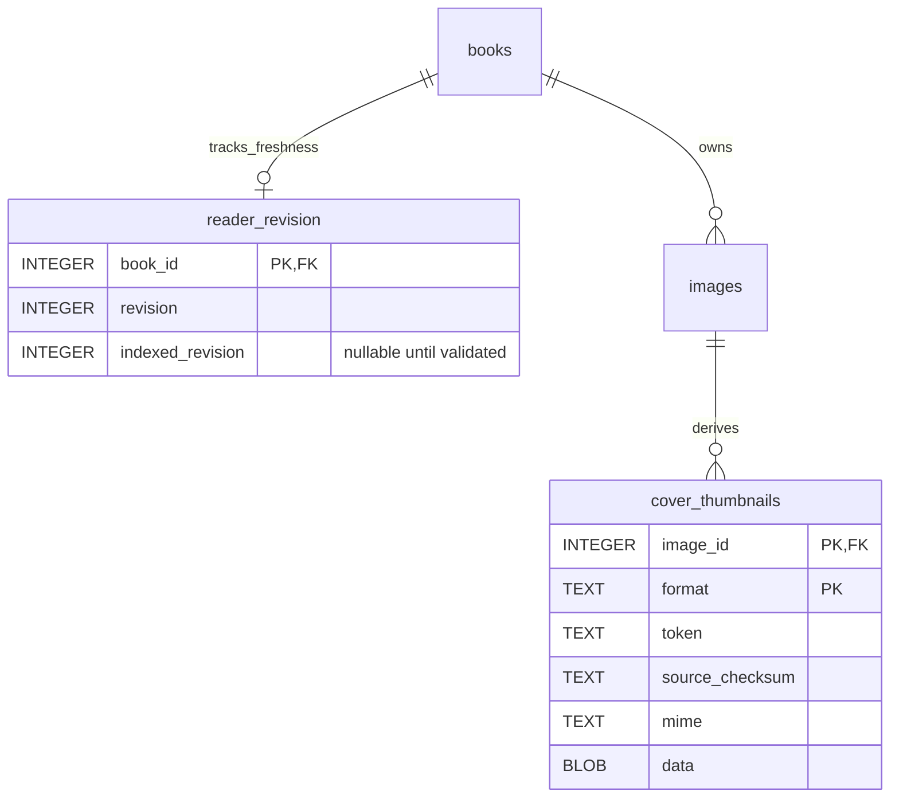

# Distill — Engineering Reference

> Split out of `docs/ERD.md` on 2026-11-11. Distill only. Platform features (reader, Kindle, sign-in, audio player) are in [`docs/shared/`](../shared/). Newest dated entries are at the top; the reference sections follow.

## 2026-11-03 — GitHub and VM synchronization

The research-table and Kindle startup/illustration changes, regression coverage,
and publication/deployment records are being committed together and synchronized
to GitHub and the VM. This records the already deployed behavior above; the sync
adds no architectural or data-model changes. Content/media and account/progress
stores remain deployment data. Physical Kindle paint verification is still
pending. Code release `575447d` is pushed to GitHub and synchronized on the VM. All
committed files match, both apps are active, and live/privacy/catalog checks
pass. CI run 41667479715 passed. Final evidence is recorded in WORK_LOG.md.

## 2026-11-02 — Research grids and NVIDIA publication

Table blocks may opt into `presentation: "grid"` (validated by the format loader).
Distill's web reader keeps these as semantic tables, explicitly includes them in
pagination, and caps each scrolling grid to its measured page height. Wheel and
touch gestures within a grid scroll its cells; page navigation remains outside
the grid. Existing table blocks retain their paragraph-flow behavior. Kindle
server rendering expands opted-in grids into splittable cell paragraphs with
repeated row/column labels and the original block index, preventing narrow,
tall tables from clipping without depending on modern browser APIs. No SQL
schema, authentication, or account/progress storage changes.

The two October 31 NVIDIA Markdown documents are imported unchanged in substance
as one entry, `nvidia-equity-research-2026-10-31`: two parts, 21 reader sections,
21 native table blocks, category `Equity research`. YAML is metadata; Markdown
links become label plus full URL under the strict-inline format, and two literal
footnote asterisks use the equivalent Unicode asterisk to avoid emphasis parsing.
Source sequence verification covers 1,331 headings, paragraphs, list items and
table cells. Local reader count is 14,626 words. Published and production-verified as book 63
on November 2, 2026; all 21 tables and sections pass live checks. Detailed
evidence is in WORK_LOG.md.

## File-media migration verified live (2026-10-28)

Production and the Mac authoring content DB now use the file-backed schema
below. The live DB is9,986,048 bytes with no `data`/BLOB image columns;886
original-image and162 thumbnail records reference1,043 verified private files
(146,541,246 bytes). Full production-copy HTTP verification and live file/hash,
foreign-key, content/reader-state and sampled authenticated HTTP checks passed.
Account/progress/pairing DB files were not changed by extraction. The current
Distill metadata archive is3,520,797 bytes and no longer embeds image bytes;
restore metadata together with the separate private media store.

## Distill home and Listen outside the reader (2026-11-08)

`distill/routes.py::library` no longer has a `tab` state (old `?tab=` links are ignored). `library.html` renders `.home-now` (the first `reading_cards` entry, `minutes_left`, other books in progress) followed by `#library`; while a book is in progress, filters and status links target `#library` (at the top of the page on desktop, so only phones move). `_brand.html` holds the mark and `site_header`, which home renders inside `.home-now` while reading. CSS grid and `position: sticky` give the desktop layout from 1000 px.

Listen outside the reader is now handled by the shared player: see "Shared audio player".

## Distill Listen: chapter audio (2026-11-07)

**Paused hold (2026-11-08).** iOS freezes a paused web app, so lock-screen Play stops reaching it. `Listener.pause()` loops a generated silent WAV on the same element for `HOLD_MS` (30 min), with the place in `held`; `listener.playing` is the real state, since `audio.paused` is false during the hold. Audio events are ignored while held.

Design: `docs/superpowers/specs/2026-11-07-distill-listen-design.md`. Plan: `docs/superpowers/plans/2026-11-07-distill-listen.md`.

- **Spoken text** (`shared/audio/spoken.py`):
  - `spoken_units(chapter)` returns `SpokenUnit(paragraph_id, parts)` per reader unit (`"<chapter_id>.<block_index>"`).
  - `p`, `h` and `quote` blocks give one part each. `ul`, `ol` and `keypoints` give one part per item. `table` and `image` are skipped.
  - The chapter title is the first part of the first unit. A chapter with nothing spoken gets one unit, `<id>.0`, holding the title.
  - `spoken_checksum` hashes the units. A mismatch makes the audio stale.
- **Engines** (`shared/audio/engines.py`):
  - `SayEngine`: `say -o`, system voice, 22,050 Hz. Output is byte-identical between runs.
  - `SiriEngine`: InkChinese's `pipeline/siri_tts.py`, run in InkChinese's venv (PyObjC) one unit per subprocess. Voice `zh-CN-D`, rate 1.0, 48 kHz.
    - It checks that `zh-CN-D` is in `siri_tts.voices()`, because the private SiriTTSService falls back silently for unknown names.
    - It retries 3 times, then raises `RenderFailed`.
  - `check_reference` renders a fixed sentence and compares it with `<db dir>/distill-voice-refs/<engine>.json`, which is gitignored.
    - `say` must match the sha256 of its PCM.
    - Siri must match duration within ±2%, since its output is not byte-repeatable (3,500 vs 3,520 ms).
- **Assembly** (`shared/audio/assemble.py`):
  - Each part is rendered and joined with silence: 350 ms between units and after the title, 250 ms between list items.
  - `compute_timings` gives each unit's start and end in ms from exact frame counts.
  - `say` records at 48 kHz (`--data-format=BEI16@48000`); the default 22 kHz cut everything above 11 kHz and sounded dull. Siri keeps its own rate.
  - The joined raw WAV is encoded once with ffmpeg to Opus 24 kbps (`-application audio`) in an MP4 container (about 12 MB per hour). That is the only file a new chapter keeps; no AAC. Chosen by ear on 2026-11-08 over AAC 32 kbps (dull) and Opus 16 kbps (8 kHz bandwidth). iPhones play Opus in MP4 from iOS 17.
  - Chapters rendered before 2026-11-08 are AAC-LC 32 kbps at 22 kHz. `encode_opus` converts that AAC to Opus 24 without re-rendering, and the AAC stays on the Mac.
- **Schema:** `chapter_audio(chapter_id PK -> chapters ON DELETE CASCADE, storage_key, text_checksum, duration_ms, voice, engine, rate, timings JSON, created_at, deploy_key)`.
  - `deploy_key` is the Opus file the server sends. For new chapters `storage_key = deploy_key` (one Opus file). For older chapters `storage_key` is their AAC and `deploy_key` is NULL until converted. Files are in the content-addressed `MediaStore`.
  - `save_chapter_audio` clears `deploy_key`, so a stale Opus file is never served. `set_deploy_audio` stores it; `missing_deploy_audio()` lists AAC-only chapters.
  - `book_audio(book_id)` returns current chapters only. `stale_or_missing_audio(book_id)` lists chapters to render.
  - Saving audio does not change `reader_revision`.
- **Deploy:**
  - `media_transfer list --media-dir` prints the keys the VM has. `deploy_db` verifies all local media, lists the VM's keys, then uploads a tar of only the missing ones.
  - Content deploys are row patches (`distill/scripts/db_patch.py`): the VM prints a hash per row of `books`, `images`, `cover_thumbnails`, `chapters` and `chapter_audio`; `build_patch` sends only differing rows; `apply_patch` runs as the service user in one transaction with deferred foreign keys and no restart. Rows are deleted only for books present locally, so live-only books survive. Reader tables are not sent; revision triggers mark changed books and the VM reindexes on demand.
  - Every `deploy_db` run ends by reading the VM back: `db_patch check` (SQLite `quick_check` and `foreign_key_check`), a fresh row-hash comparison that must find nothing to send, and every referenced media key present. Any failure fails the deploy; a run with nothing to send is therefore a full check of the live database.
  - Siri stops at about 26 s of speech per sentence (about 130 Chinese characters) and reports success. `SiriEngine` records pieces of at most 90 characters (`split_for_siri`, cut at sentence ends, then clause marks), joins them with 150 ms of silence, and fails any piece of 25.5 s or more. Audio recorded before this has voice `siri:zh-CN-D@1.0` (`CUT_OFF_VOICES`): it keeps playing, and `make_audio` treats it as stale.
  - `media_keys` includes `chapter_audio` (both keys locally).
  - `media_transfer prune --db --media-dir` deletes media objects referenced by neither the live DB nor the content DB inside `backups/<stem>-latest.tar.gz`, skipping anything modified in the last 24 h (the app may be mid-write); an unreadable backup stops it. `deploy_db` runs it last, after the VM is verified; a prune failure only warns and is reported in the deploy summary.
  - In the shipped snapshot, `deploy_db` sets `storage_key = deploy_key` wherever it is set, so the VM DB references only Opus files and no AAC is uploaded. An AAC-only chapter ships its AAC until converted.
  - The VM must run this code before an audio push, since the push relies on its `list` command.
- **Command:** `python -m shared.audio.make_audio --app distill (--book SLUG | --all) [--dry-run] [--approve-voice] [--opus-only] [--jobs N] [--deploy]`.
  - Renders only stale or missing chapters, so runs can resume. Stops a book on its first failure. Each render saves one Opus file.
  - `--opus-only` converts AAC-only chapters to Opus 24 (no voices, no rendering).
  - Siri paths come from `DISTILL_SIRI_TTS_PATH` / `DISTILL_SIRI_PYTHON` in `deploy/distill/deploy.local.env`.
  - Measured speed: `say` about 3.7× real time per process; Siri about 5×.
- **Routes:**
  - `GET /books/<slug>/audio/<chapter_id>.m4a`: login required. Serves `deploy_key` (Opus), else an older chapter's AAC `storage_key`, as `audio/mp4`. `send_file(conditional=True)` handles Range, giving 206 or 416. `Cache-Control: private, no-cache` with the served file's key as ETag, because the URL stays the same across re-renders. Stale or missing audio returns 404.
  - `GET /api/books/<slug>/audio` returns `{book_id, chapters:[{chapter_id, ordinal, title, url, duration_ms, timings}]}`.
- **Player** — replaced 2026-11-09 by "Shared audio player"; the notes below are history. Shared reader platform (2026-11-08): `shared/static/js/listen.js`, `shared/templates/shared/reader/_listen_bar.html`, `shared/static/css/listen.css`. An app constructs `new Listener(reader, book, {audioApi, storageKey, mode})` on top of the shared continuous reader and includes the bar and CSS. Distill passes `/api/books/<slug>/audio`, `distill-listen-<book_id>` and `summary` (`distill/static/js/distill_reader.js`). Plainly has no timed audio yet, so it does not construct one.
  - One `<audio>` element. Sets `navigator.audioSession.type='playback'` where available. Media Session supplies metadata and action handlers.
  - The bar is moved into `.continuous-reader-footer`, so `calculatePages` subtracts its height. Showing or hiding it dispatches `resize`.
  - Following drives the reader's own `displayCurrentPage` / `loadContinuousReaderAt`, so normal page-turn progress saving applies. While following, every `timeupdate` maps (unit, offset through it) to a page with `findContinuousPageForMarker`, so the page turns inside a paragraph that runs onto the next page, not only when a new paragraph starts.
  - Following stops only on a page turn by the reader, playing or paused: the listener wraps `navigateToNextPage` / `navigateToPreviousPage` (every key, tap, swipe and button turn) and watches clicks on contents entries (`[data-reader-chapter-target]`). Re-layouts (the bar appearing, resize, settings) and the player's own turns (`navigating`) do not count. Before 2026-11-08 a displayed page without the spoken paragraph turned following off, which the bar's own re-layout triggered on phones.
  - While not following, the bar shows **Back to audio** (`#listen-follow`: show the playing paragraph, follow again) and **Play from here** (`#listen-here`: `listenFromReadingPosition`, restart at the paragraph at the top of the page). Play/pause continues the audio and never moves the page.
  - `localStorage[storageKey] = {chapter_id, paragraph_id, ms, title, rate, at}` (Distill: `distill-listen-<book_id>`, also read by its book page).
  - Server saves set the reader's `currentMarker` to `{mode, chapter_id, paragraph_id, offset}`, where offset is the fraction of the unit played, and call `saveContinuousReader('listen')`. `listen` was added to `VALID_CAUSES`.
- **Tests:**
  - pytest: `tests/distill/test_audio_*.py`, `test_make_audio.py`, plus additions to `test_models.py`, `test_deploy_db.py` and `test_file_media.py`.
  - WebKit e2e: `tests/e2e/distill_listen.mjs`. It needs a book with rendered audio (`DISTILL_LISTEN_SLUG`).
- **Worktree testing:** `tests/distill` is a package named `distill`, so in a git worktree plain `pytest` imports the main checkout's `distill.*` through the editable install. Remap the editable finder's `MAPPING` to the worktree, or run from the main checkout.

## Distill image files and metadata schema (2026-10-27)

Distill `images` now stores `(id, book_id, name, mime, storage_key)`;
`cover_thumbnails` stores `(image_id, format, token, source_checksum, mime,
storage_key)`. No image bytes remain in either table after migration.
`storage_key` is the lowercase SHA256 of the exact encoded image bytes; files
live at `<media-root>/<first-two-hex>/<sha256>`. Default root is beside the
configured content DB as `<stem>-media`, normally `data/distill-media/`, with
`DISTILL_MEDIA_DIR`/constructor override support. Path validation rejects
arbitrary paths. The directory stays outside public static aliases and inside
the existing systemd writable `data/` sandbox. HTTP authorization still applies
to `/books/<slug>/images/<name>` and `/books/<slug>/cover/<token>.<format>`.

Writes use same-directory temporary files, checksum verification, fsync and
atomic replace before a database reference can commit. Hash-named objects are
immutable and deduplicated; reimports do not delete old objects because older
metadata backups may still reference them. Reads keep the existing MIME/bytes
interface and authenticated URL/cache behavior. Missing files produce the
existing not-found response. Backfill encodes before requests as before.

Startup detects legacy image BLOB columns, exports/verifies their bytes and
rebuilds both tables atomically with original IDs/sequences/tokens and foreign
keys intact. Failure rolls back database changes; written unreferenced objects
are harmless. Explicit offline `migrate_media --compact` verifies all references
and VACUUMs; content, chapter IDs, reader units and separate account/progress/
pairing databases stay intact. Future restores require metadata plus the media
store; a DB archive alone no longer contains Distill's images.

Deployment snapshots metadata consistently, uploads only referenced immutable
media objects, checks transfer hashes and installs them before DB activation.
The remote helper refreshes one consistent metadata archive per app rather than
raw backup accumulation. No Plainly schema/auth changes are required.

## Distill book action styling (2026-10-27)

`distill/templates/book.html` groups the primary reading link, restart link and read-status button in `.distill-book-actions`. App-scoped CSS gives all three the same inherited font family, .9rem size, 600 weight, 1.4 line-height, padding and minimum 44px height. A wrapping flex row supplies shared spacing; the primary action keeps its filled treatment and both secondary actions share underline/hover/focus styling. The live status announcement remains outside the action row. Presentation only; no architectural, data-model, route or progress behavior changes.

## Distill app (2026-10-25; updated 2026-10-26)

Distill is a private reader for book summaries, served at `/distill` behind Apache OIDC. Code: `distill/`. Tests: `tests/distill/`. Design: `docs/superpowers/specs/2026-10-24-distill-design.md`.

### Routes

| Route | Notes |
|---|---|
| `GET /` | Library: Reading now, Finished, then All books; six-card expandable shelves, status badges, filters, sorting and estimated reading times. |
| `GET /books/<slug>` | Book page: cover, progress, Start or Continue reading, contents grouped by part (built from `get_chapter_outline` and `count_chapters`, so no chapter blocks are loaded). Source is the final chapter; explicit Read/unfinished and separate restart controls preserve saved-place resume. An unknown slug renders `not_found.html` with 404. |
| `GET /books/<slug>/read` | Reader shell. The JS opens at `?chapter=<chapter id>` or the saved place. The Kindle reader at the same URL takes `?ch=<ordinal>` and also maps `?chapter=<id>` to its ordinal (an explicit `ch` wins), so a web contents link works on a Kindle. |
| `GET /books/<slug>/images/<name>` | The private image route: `login_required`, `Cache-Control: private, max-age=3600`, ETag and 304, `nosniff`. |
| `/api/reader/*`, `/api/progress/*`, `/api/auth/check` | From the shared platform. |
| `POST /api/kindle/progress` | Thin route over `shared.kindle.progress.save_progress` (`ch` is the chapter ordinal). |

Book pages, book images, reader assets, APIs and the service worker require authentication. The content-free PWA launch screen, installation metadata, named branding assets and Kindle pairing bootstrap are the narrow public exceptions described below. Kindle pages are served from the same URLs by the shared Kindle dispatch (a `before_app_request` that skips `@login_required`), so Distill’s `install_pairing` authentication hook must run before any blueprint is registered. That order is what keeps Kindle pages private (`test_kindle_pages_and_progress_need_the_allow_list`). An `after_request` hook gives every non-static response without a `Cache-Control` the value `private, no-cache`.

### Auth and environment

- `DISTILL_AUTH_MODE`: `off` (the default when unset; local dev) or `required`. `optional` is rejected, since Distill content is private. `distill.app_prod` raises unless it is `required`.
- `DISTILL_ALLOWED_EMAILS`: the allow-list (pchauth, prefix `DISTILL`). A signed-in email not on it gets 403 on a page, an image and a segment. It must be non-empty when the mode is not `off`.
- Production access update (2026-11-07): add the owner-authorized invited account to `/opt/summra/distill.env`, preserving existing entries, then restart only `distill.service` to reload configuration. Plainly/OpenReader have separate app allowlists; MathPad/InkChinese and protected `/pages/` also use host-owned Apache claim policies. Google sign-in alone does not bypass app-level checks. No authentication-mode, schema, shared catalog, account isolation or administrative-role changes are required.
- `DISTILL_DB` and `DISTILL_USER_DB` (defaults `data/distill.db` and `data/distill_user.db`), `DISTILL_HOST` (default `127.0.0.1`: the dev server runs with auth off, so it binds loopback), `PORT` (5003), `DISTILL_STATIC_DIR_OVERRIDE`.
- **Normal browser sign-in comes from Apache.** Phones/desktops use its Google OIDC redirect; Kindle e-reader UAs pass through to Distill’s device-auth hook and HTML navigation redirects to `/pair` when unauthenticated. Other unauthenticated requests return JSON 401; unlisted OIDC emails return 403. The device session is Distill-only and the phone approval/revocation routes always force Google OIDC. Verify both device classes at the public gateway after deployment.
- **Accepted risk: same-origin XSS.** Plainly and Distill share an origin, so script running on a `/plainly` page could `fetch('/distill/...')` with the owner's OIDC cookie. Plainly renders only owner-controlled content with escaped values, so the risk is accepted. A later hardening step is a `Content-Security-Policy` on `/distill/`, or moving Distill to its own subdomain.
- Production entry: `distill.app_prod:app`, served by the env-driven `deploy/gunicorn_config.py` (`GUNICORN_BIND`, `GUNICORN_WORKERS`, `GUNICORN_PIDFILE`, `GUNICORN_PROC_NAME`: a second app on the VM must set its own bind, pidfile and proc name or gunicorn refuses to start beside Plainly's). Production runs in `/opt/summra` under the `distill.service` user unit on loopback port 5002; Plainly uses `summra.service` on port 5001. Apache routes `/distill/` using `deploy/distill/distill.conf`. Host environment files and content/user databases remain deployment-owned.

### Two databases

- **Content DB** (`data/distill.db`, `DistillDatabase(ReaderIndexMixin)`): `books` (slug, title, author, lang, cover_image_id, sources, imported_at, content_checksum), `chapters` (`book_id`, `ordinal`, `part_title`, `title`, `blocks` JSON), `images` (name, mime, BLOB), plus the reader index tables. Ordinal 0 is the Overview when the book has one. Import with `venv/bin/python -m distill.scripts.push_book <folder> [--dry-run] [--db PATH]`, which validates the folder against `distill/book_format.py` (format v1) first.
- **User DB** (`data/distill_user.db`, the shared `UserDatabase`): users, reading progress and mutations. It is separate from Plainly's `summra.db`, so a Distill deploy or copy cannot touch Plainly's data.

**Re-import keeps chapter ids by ordinal.** Importing a slug again upserts `chapters` by `(book_id, ordinal)`, so the book id and chapter ids stay the same (saved places carry chapter ids), and chapters past the new count are deleted. A chapter inserted mid-book therefore shifts content under the existing ids: a saved place on chapter 7 now points at whatever is chapter 7. Quote recovery runs only within the marker's own chapter, so it can repair a moved paragraph but cannot follow a chapter that moved. Prefer appending chapters, or accept that readers of that book lose their place.

### Units are block JSON

`_reader_chapter_units` stores each block as a canonical JSON string (`sort_keys`), one reader unit per block, in mode `summary` only. The client's `classifyUnit` is `JSON.parse` and `blocks.js` renders the result. Kindle pages render the same blocks with `shared.reader.blocks.block_element`. Word counts and quote recovery use `block_text` (re-exported by `book_format`). The word count is CJK-aware (per character) via `book_format.word_count`.

### Config

`DISTILL_READER`: `summary` only (so the selector never shows), `cache_db_name='distill-reader-v1'`, `cache_visibility='private'`, `inline='strict'`, `image_base=''`, `illustrations=False`, `automatic_completion=False`, Kindle on with the single text mode `summary`, and `extra_page_blocks='table.reader-table, figure.reader-figure'`. Page fit is CSS in the shared `reader.css` (the block vocabulary styles); only the "Key points" / "要点" label is in `distill.css`. A figure image is a fixed `40vh` box with `object-fit: contain`, and tables, lists and keypoints scroll inside a `calc(100dvh - 180px)` box, so nothing is clipped on a 375x667 phone.

### TOC import and repair

`book_format.normalize_toc_titles` runs during import: remove duplicated chapter/parent prefixes while preserving meaningful numbers, distinguish opening overviews from Introductions, and use concise section-overview labels. `DistillDatabase.repair_toc(dry_run=True)` previews existing-title repairs; `dry_run=False` updates titles in place without replacing chapter IDs or blocks.

`iter_chapters` appends Source from the book's source blocks. `append_source_chapters(dry_run=True)` previews an idempotent terminal Source append/update for existing books. Source remains in book metadata as well. The deployed backfill added 54 terminal chapters, taking the collection from 1,564 to 1,618 chapters without renumbering existing IDs. These targeted repairs preserve positions; arbitrary middle-of-book re-imports retain the ordinal limitation above.

### Derived content schema and freshness

The following relationships are in the content database; account progress remains in the separate user database. `reader_revision` is shared by Plainly and Distill; `cover_thumbnails` is Distill-specific.

`create_reader_revisions` installs SQL triggers for book inserts and chapter inserts/updates/deletes, including both books when a chapter moves. Plainly additionally tracks `is_poetry` and book-section changes, including linked books. Both hosts enable `_reader_revision_tracking`. Distill migrates legacy `distill_reader_revision` values and removes the legacy table/triggers, retaining reader versions and unit IDs.

A clean `ensure_reader_content` joins revision/version metadata without loading source content or writing. A dirty check acquires `BEGIN IMMEDIATE`, rechecks freshness, validates the source checksum, recompiles only if changed, and publishes `indexed_revision` in the same transaction. Failures roll back; competing workers cannot publish a stale index. Hosts without revision tracking retain checksum checks. Source text remains in host chapter storage; the index contains coordinates and counts.

`library_word_totals(book_ids)` refreshes dirty books and groups indexed counts by book/mode instead of loading each manifest. Library projections and chapter counts are batched; book-page progress lookups are scoped to the selected book. Identity/allow-list checks still occur each request, while unchanged user identity avoids a login timestamp write within five minutes. Production warm all-book totals measured about 80ms for 90 Plainly books and 2.7ms for 54 Distill books; these are observed measurements, not latency guarantees.

### Explicit Read status and progress preservation

`POST /api/progress/v2/books/<book_id>/status` requires authentication and JSON `status: "read"` or `"reading"`. It resolves the authoritative saved marker/mode (or a first readable marker when no state exists), then calls the existing revision-checked mutation path with `manual_finish` or `manual_unfinish`. Accepted actions return 200; conflicts return 409. No new progress tables or columns were added.

Read sets `book_reading_state.status=finished`; unfinished sets `in_progress`. Preserve current/furthest markers, accumulated reading time and existing mutation history. Distill disables automatic completion in both clients and server validation, so stale terminal-page clients cannot finish a book. Plainly keeps automatic completion enabled.

On platform installation for hosts opting out, `UserDatabase.clear_automatic_completions()` changes finished records without an accepted `manual_finish` history to `in_progress`, clears `finished_at`, and advances book `revision` and `completion_revision`. It does not change mode rows or delete history; reruns leave explicit Read records intact. The deployed conversion changed two automatic flags after an online user-DB backup and verified mode rows/history unchanged.

Reader exit waits at most 250ms for a pending save; keepalive requests can continue through navigation. Save/conflict feedback and retry/reload controls expose failures. Distill Reading now and Finished cards use a single native anchor around the complete card (cover, title, progress, action and whitespace); the action is a non-interactive span to avoid nested links. Keyboard focus is visible, and the existing saved-place/return URL is retained. Plainly cards without `read_href` retain their JS-controlled markup. Verified on the VM on 2026-10-26: all three live shelf cards render full-card reader anchors and the focus styling is served. No data-model change. Finished cards and book pages resume the current marker by default; only the separate `restart=1` action starts from the beginning. Return URLs must be internal and prefix-scoped; session scroll restoration and back-forward-cache refresh retain library context.

### Installation and cache boundaries

- iOS `apple-touch-icon` links on all web pages, including the signed-out launch, use the existing opaque 512×512 drop PNG with an accurate `sizes` declaration and content-hashed URL. This replaces the separate 180×180 touch-icon selection; manifest identity and icon access rules are unchanged. Existing Home Screen installs may retain an OS-cached image until re-added.
- `/launch`, `/manifest.webmanifest`, `/favicon.ico` and `/app-icons/<name>` are public. Icon names are limited to favicon.svg, favicon.ico and icon-32/180/192/512.png. Distill’s authentication hook exempts these exact endpoints; Apache has matching narrow exceptions and strips the trusted identity header on those public paths.
- Manifest `id` and `scope` retain the live prefix (`/distill/`); `start_url` is `/distill/launch`. The manifest uses standalone display, drop icons and colors `#8A2E2E` / `#FBF8F1`. Head/manifest links use the public app-icon paths so anonymous OS fetches receive the drop rather than an authentication redirect. Existing installed icons can remain OS-cached until reinstall; account progress is unaffected.
- `/launch` renders only inline sign-in controls and public branding, with `Cache-Control: no-store`; it requires no private JS/CSS or account identity. A credentialed, no-store session check uses manual redirect handling, so an expired OIDC session leaves the Sign in link visible rather than fetching the identity provider as an API response. A valid session replaces the launch URL with the library. Returning to the launch screen rechecks the session.
- Deployment verified 2026-10-26: public HTTPS launch/manifest return 200; private routes redirect signed-out requests to OIDC. Authenticated loopback checks confirm the library, book, worker and login return. Apache configuration validation and both service health checks pass.
- `/login` remains protected by Apache OIDC and the app allow-list. A top-level Sign in navigation performs the gateway flow and returns to this route, which redirects to the private library. No passwords, tokens or progress are stored by the launch screen. Existing installations may retain the previous root start URL until their manifest updates; root visits still trigger OIDC normally.
- `/sw.js` remains authenticated, `private, no-cache`, with `Service-Worker-Allowed` set to the live prefix. The worker is network-only, with a scoped navigation retry fallback and no Cache Storage persistence.
- Matching content-hashed static URLs are `private, max-age=31536000, immutable`; bare native-module URLs are `private, no-cache`. Shared reader content IndexedDB remains app-namespaced. Neither workers nor IndexedDB provide durable local progress.

### Images

An `image` block's `src` is `images/<name>`. On the web reader `image_base=''` makes it resolve against `/books/<slug>/read` to the image route. The book page and the Kindle pages pass an explicit base (`<base>/books/<slug>/`), since they are at other URLs. Book images are never served from a static path and require sign-in; public branding icons are separate.

Cover derivatives are encoded during import/backfill, before the write transaction, never in a request. `generate_cover_thumbnails()` is idempotent. EXIF orientation is applied, transparency receives a white backing, and size is bounded to 320×480 without upscaling. Formats: AVIF quality 60/speed 6, WebP quality 80 and optimized JPEG quality 82 (Pillow with AVIF support required).

`GET /books/<slug>/cover/<token>.<format>` authenticates, checks the stored token/format, and serves an ETag with `private, max-age=31536000, immutable`; unknown tokens/formats return 404. Library/book-page `<picture>` prefers AVIF then WebP then JPEG; shelf covers are lazy-loaded, book-page covers eager, Kindle uses JPEG. Original images and reader illustrations are unchanged. The deployed 54-cover/162-variant backfill reduced AVIF bytes from 3,840,055 original bytes to 794,971 (about 79%).

### Progress label

`distill.routes.progress_label(card, chapter_count)` returns `Overview` at ordinal 0, `Source` for the terminal Source chapter, otherwise `Chapter n of m` where `m` counts chapters excluding the Overview, and an empty string with no place saved. The Library's "Reading now" cards and the book page use it as the location line (cards reuse the shared `library_card` macro, which prints `current_chapter.chapter_title`).

### Kindle mode

`distill/kindle_routes.py`: the library (Reading now, up to 3 on the first page with a "See all" link, then All books at 4 per page), the contents (8 per page, part headings, "You are here") and the reader at the web reader's URL with `?ch=<ordinal>`. A `ch` that is not ASCII digits, or unknown, is a 404. Templates are in `distill/templates/kindle/` and the CSS is `distill/static/css/distill_kindle.css`. The shared ES5 `kindle.js` pages the chapter; a small book-page XHR handler posts explicit Read/unfinished actions. The only text is `summary`, so there is no Text row. Progress goes through the shared `save_progress` with Distill's `position` hook (`get_chapter(book_id, ordinal)`; the quote is the block's text, single-spaced and cut to 180 characters, or `None` for a block with no text). `DistillDatabase.get_chapter_outline` and `get_chapter` serve the lists and the reader.

### Tests

`tests/distill/` (pytest), `tests/js/` (node) and `tests/e2e/distill.mjs`. The e2e covers: library to book to reader, no mode selector, image and table chapters without overflow, the `keypoints` label in English and Chinese, reload restores the anchor, Reading now, IndexedDB holds `distill-reader-v1` and not `summra-reader-v2`; a 375x667 mobile pass; and a 758x950 Kindle pass (no module script, no `tr` or `figure` split across columns, a tap turns the page).

### 2026-11-03 — Shared article publishing skill

Added `skills/distill-publish/` as a portable Claude/Codex workflow over the existing book-format/import/deploy modules. It documents full-catalog preflight, SQLite backups, separate content/progress stores, and web-grid/Kindle table behavior. No application architecture, database schema, or runtime behavior changes.

### 2026-11-04 — Home browser title

The Distill web library template renders the document title as `Distill`. This presentation-only change has no architecture, data model, or storage impact.

### 2026-11-03 — Omit absent author markup

Distill web library/book templates, search suggestions and Kindle library/contents templates omit author elements for null, empty or whitespace-only author values. The shared server-rendered Continue reading card follows the same condition. Author data remains optional and unchanged in storage/APIs; no database or architectural changes.

### 2026-11-04 — Distill Reading desk and browse typography

The web book-details template uses a jacket/sidebar and a contents column, stacking on narrow screens. Native `details`/`summary` groups keep chapter order/links and `aria-current`; the saved chapter's named part opens by default, otherwise the first named part opens. Untitled groups (including Overview and Source) remain directly visible. The route loads only the ordinal-0 overview for a plain, escaped, at-most-420-character jacket excerpt (plus ellipsis), skipping a leading title/edition paragraph when a following paragraph exists. Outline/progress queries remain separate; no full manifest or full-book block load is added. No schema, content or progress-coordinate changes.

`distill-browse` scopes the fixed light palette, serif English title stack, sans UI/body stack and self-hosted LXGW WenKai v1.311 regular face to library/book browsing, leaving reader and Kindle typography/theme controls intact. The OFL license ships beside the WOFF2 in `distill/static/fonts/`. The font is requested on use and does not contact an external font provider. The library catalog carries `lang` for search suggestions; Distill cards carry it for titles, and the shared server-rendered card title has a language attribute (defaults to English). No Plainly font styles change. No new feature flag; applies to all Distill web browsing after deployment.
